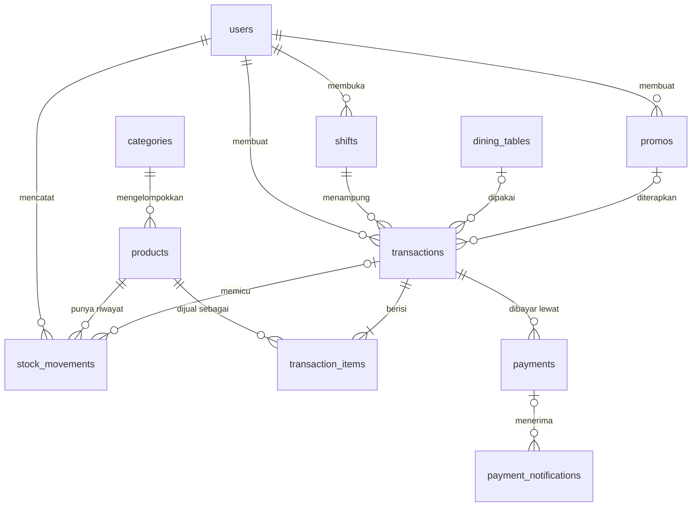

# Desain Database — Coffee POS

| Item | Keterangan |
|---|---|
| Acuan | [PRD.md](PRD.md) v1.0 |
| Database | MySQL ≥ 8.0.16 (dibutuhkan agar `CHECK` constraint benar-benar ditegakkan) |
| Engine / Charset | InnoDB, `utf8mb4` / `utf8mb4_0900_ai_ci` |
| Tanggal | 27 Oktober 2026 |

**Konvensi umum**
- Primary key: `id VARCHAR(36)` berisi UUID yang di-generate aplikasi Go. Tidak ada `AUTO_INCREMENT`.
- Uang: `BIGINT` dalam satuan **sen** (Rp 1 = 100 sen). Contoh: Rp 25.000 disimpan sebagai `2500000`.
- Semua tabel punya `created_at` dan `updated_at` (`TIMESTAMP`). Tabel master yang direferensikan transaksi punya `deleted_at` (`TIMESTAMP NULL`).
- Kolom status dengan nilai terbatas memakai `ENUM`.
- Semua foreign key memakai `ON DELETE RESTRICT ON UPDATE RESTRICT` (lihat keputusan desain D-08).

Definisi `created_at` dan `updated_at` sama di semua tabel, jadi tidak diulang di setiap tabel:

| nama_kolom | tipe_data | constraint | keterangan |
|---|---|---|---|
| created_at | TIMESTAMP | NOT NULL DEFAULT CURRENT_TIMESTAMP | Waktu baris dibuat (UTC) |
| updated_at | TIMESTAMP | NOT NULL DEFAULT CURRENT_TIMESTAMP ON UPDATE CURRENT_TIMESTAMP | Waktu baris terakhir diubah (UTC) |

---

## 1. Daftar Tabel

| # | Tabel | Deskripsi | Soft delete |
|---|---|---|---|
| 1 | `users` | Akun Owner dan Cashier beserta role dan status aktif. | Tidak (pakai status) |
| 2 | `categories` | Kategori produk (Kopi, Non-Kopi, Makanan, dll.) dan urutan tampilnya di kasir. | Ya |
| 3 | `products` | Master menu: harga, foto, status, dan stok saat ini. | Ya |
| 4 | `stock_movements` | Riwayat pergerakan stok (append-only), sumber kebenaran untuk nilai stok. | Tidak |
| 5 | `dining_tables` | Master meja dan status okupansinya. | Ya |
| 6 | `promos` | Master promo/diskon persentase dan nominal. | Ya |
| 7 | `shifts` | Shift kasir: modal awal, kas aktual, dan rekap penutupan. | Tidak |
| 8 | `transaction_sequences` | Counter harian untuk nomor transaksi `TRX-YYYYMMDD-XXXX`. | Tidak |
| 9 | `transactions` | Header transaksi penjualan: total, diskon, status, dan snapshot promo. | Tidak (final) |
| 10 | `transaction_items` | Detail item per transaksi dengan snapshot nama dan harga produk. | Tidak |
| 11 | `payments` | Setiap percobaan pembayaran (Snap token Midtrans atau tunai) per transaksi. | Tidak |
| 12 | `payment_notifications` | Log mentah setiap webhook Midtrans untuk audit dan idempotensi. | Tidak |

---

## 2. Detail Kolom per Tabel

### 2.1 `users`

| nama_kolom | tipe_data | constraint | keterangan |
|---|---|---|---|
| id | VARCHAR(36) | PK | UUID |
| full_name | VARCHAR(100) | NOT NULL | Nama lengkap |
| username | VARCHAR(50) | NOT NULL, UNIQUE | Username untuk login |
| password_hash | VARCHAR(255) | NOT NULL | Hash bcrypt. Password asli tidak pernah disimpan |
| role | ENUM('OWNER','CASHIER') | NOT NULL | Role user |
| status | ENUM('ACTIVE','INACTIVE') | NOT NULL DEFAULT 'ACTIVE' | User `INACTIVE` tidak bisa login |
| token_version | INT UNSIGNED | NOT NULL DEFAULT 0 | Dinaikkan saat user dinonaktifkan atau password direset. JWT menyimpan versi ini, jadi token lama langsung tidak berlaku |
| last_login_at | TIMESTAMP | NULL | Waktu login terakhir |
| owner_guard | TINYINT | GENERATED ALWAYS AS (CASE WHEN role = 'OWNER' THEN 1 END) STORED, UNIQUE | Menjamin hanya ada **satu** Owner (D-06) |
| created_at, updated_at | TIMESTAMP | lihat konvensi | |

### 2.2 `categories`

| nama_kolom | tipe_data | constraint | keterangan |
|---|---|---|---|
| id | VARCHAR(36) | PK | UUID |
| name | VARCHAR(50) | NOT NULL | Nama kategori |
| sort_order | INT | NOT NULL DEFAULT 0 | Urutan tab di layar kasir (kecil tampil lebih dulu) |
| status | ENUM('ACTIVE','INACTIVE') | NOT NULL DEFAULT 'ACTIVE' | |
| deleted_at | TIMESTAMP | NULL | Soft delete |
| name_active | VARCHAR(50) | GENERATED ALWAYS AS (CASE WHEN deleted_at IS NULL THEN name END) STORED, UNIQUE | Nama unik hanya di antara kategori yang belum dihapus (D-06) |
| created_at, updated_at | TIMESTAMP | lihat konvensi | |

### 2.3 `products`

| nama_kolom | tipe_data | constraint | keterangan |
|---|---|---|---|
| id | VARCHAR(36) | PK | UUID |
| category_id | VARCHAR(36) | NOT NULL, FK → categories.id | |
| sku | VARCHAR(50) | NOT NULL | Kode produk |
| name | VARCHAR(100) | NOT NULL | Nama menu |
| description | TEXT | NULL | Deskripsi opsional |
| price | BIGINT | NOT NULL, CHECK (price >= 0) | Harga jual dalam sen |
| photo_path | VARCHAR(255) | NULL | Path/key file foto di storage, bukan URL penuh. URL dibentuk aplikasi |
| status | ENUM('ACTIVE','INACTIVE') | NOT NULL DEFAULT 'ACTIVE' | Produk `INACTIVE` tidak muncul di kasir |
| track_stock | BOOLEAN | NOT NULL DEFAULT FALSE | `TRUE` = stok dilacak (kue, minuman botol) |
| stock | INT | NOT NULL DEFAULT 0 | Stok saat ini, signed (D-09). Hanya diubah bersamaan dengan insert ke `stock_movements` |
| min_stock | INT | NOT NULL DEFAULT 0, CHECK (min_stock >= 0) | Batas peringatan "stok menipis" |
| deleted_at | TIMESTAMP | NULL | Soft delete |
| sku_active | VARCHAR(50) | GENERATED ALWAYS AS (CASE WHEN deleted_at IS NULL THEN sku END) STORED, UNIQUE | SKU unik di antara produk yang belum dihapus |
| created_at, updated_at | TIMESTAMP | lihat konvensi | |

Index: `idx_products_category_status (category_id, status, deleted_at)`.

### 2.4 `stock_movements`

| nama_kolom | tipe_data | constraint | keterangan |
|---|---|---|---|
| id | VARCHAR(36) | PK | UUID |
| product_id | VARCHAR(36) | NOT NULL, FK → products.id | |
| movement_type | ENUM('IN','OUT_SALE','ADJUSTMENT','WASTE','RETURN_VOID') | NOT NULL | Jenis pergerakan (PRD 3.3) |
| quantity | INT | NOT NULL | Delta bertanda: positif = masuk, negatif = keluar. Lihat CHECK di bawah |
| stock_before | INT | NOT NULL | Stok sebelum pergerakan |
| stock_after | INT | NOT NULL, CHECK (stock_after = stock_before + quantity) | Stok sesudah pergerakan |
| transaction_id | VARCHAR(36) | NULL, FK → transactions.id | Diisi untuk `OUT_SALE` dan `RETURN_VOID` |
| note | VARCHAR(255) | NULL | Wajib diisi untuk `ADJUSTMENT` dan `WASTE` |
| is_oversold | BOOLEAN | NOT NULL DEFAULT FALSE | `TRUE` jika stok menjadi negatif karena race condition (BR-11) |
| created_by | VARCHAR(36) | NOT NULL, FK → users.id | User pelaku. Untuk `OUT_SALE` diisi cashier pemilik transaksi |
| created_at, updated_at | TIMESTAMP | lihat konvensi | Tabel append-only, jadi `updated_at` selalu sama dengan `created_at` |

CHECK tambahan:
- `chk_sm_sign`: `(movement_type IN ('IN','RETURN_VOID') AND quantity > 0) OR (movement_type IN ('OUT_SALE','WASTE') AND quantity < 0) OR (movement_type = 'ADJUSTMENT' AND quantity <> 0)`
- `chk_sm_note`: `movement_type NOT IN ('ADJUSTMENT','WASTE') OR (note IS NOT NULL AND note <> '')`
- `chk_sm_ref`: `movement_type NOT IN ('OUT_SALE','RETURN_VOID') OR transaction_id IS NOT NULL`

Index:
- `uq_sm_idempotency UNIQUE (movement_type, transaction_id, product_id)`: satu transaksi hanya bisa mengurangi stok satu produk **sekali**. Ini pengaman kedua jika webhook diproses ganda (BR-23). Baris manual punya `transaction_id` NULL sehingga tidak terkena batasan ini.
- `idx_sm_product_time (product_id, created_at)`: riwayat stok per produk.
- `idx_sm_type_time (movement_type, created_at)`: filter riwayat berdasarkan tipe.

### 2.5 `dining_tables`

Nama `dining_tables` dipakai agar tidak rancu dengan keyword SQL `TABLE`/`TABLES`.

| nama_kolom | tipe_data | constraint | keterangan |
|---|---|---|---|
| id | VARCHAR(36) | PK | UUID |
| table_number | VARCHAR(20) | NOT NULL | Nomor/nama meja, mis. "A1" atau "Outdoor 3" |
| capacity | TINYINT UNSIGNED | NOT NULL DEFAULT 2, CHECK (capacity >= 1) | Jumlah kursi |
| occupancy_status | ENUM('AVAILABLE','OCCUPIED') | NOT NULL DEFAULT 'AVAILABLE' | Status okupansi untuk tampilan kasir |
| status | ENUM('ACTIVE','INACTIVE') | NOT NULL DEFAULT 'ACTIVE' | Meja nonaktif tidak bisa dipilih |
| deleted_at | TIMESTAMP | NULL | Soft delete |
| number_active | VARCHAR(20) | GENERATED ALWAYS AS (CASE WHEN deleted_at IS NULL THEN table_number END) STORED, UNIQUE | Nomor meja unik di antara meja yang belum dihapus |
| created_at, updated_at | TIMESTAMP | lihat konvensi | |

### 2.6 `promos`

| nama_kolom | tipe_data | constraint | keterangan |
|---|---|---|---|
| id | VARCHAR(36) | PK | UUID |
| name | VARCHAR(100) | NOT NULL | Nama promo, mis. "Happy Hour 20%" |
| code | VARCHAR(30) | NULL | Kode promo opsional |
| discount_type | ENUM('PERCENTAGE','FIXED') | NOT NULL | |
| discount_percent | TINYINT UNSIGNED | NULL | 1–100, hanya untuk `PERCENTAGE` |
| discount_amount | BIGINT | NULL | Potongan dalam sen, hanya untuk `FIXED` |
| max_discount | BIGINT | NULL, CHECK (max_discount IS NULL OR max_discount > 0) | Batas potongan (sen) untuk `PERCENTAGE` |
| min_purchase | BIGINT | NOT NULL DEFAULT 0, CHECK (min_purchase >= 0) | Minimum subtotal (sen) |
| starts_at | TIMESTAMP | NOT NULL | Mulai berlaku (UTC) |
| ends_at | TIMESTAMP | NOT NULL, CHECK (ends_at > starts_at) | Akhir berlaku (UTC) |
| status | ENUM('ACTIVE','INACTIVE') | NOT NULL DEFAULT 'ACTIVE' | |
| created_by | VARCHAR(36) | NOT NULL, FK → users.id | Owner pembuat promo |
| deleted_at | TIMESTAMP | NULL | Soft delete. Promo yang sudah dipakai tidak boleh di-hard delete |
| code_active | VARCHAR(30) | GENERATED ALWAYS AS (CASE WHEN deleted_at IS NULL THEN code END) STORED, UNIQUE | Kode unik di antara promo yang belum dihapus (NULL boleh lebih dari satu) |
| created_at, updated_at | TIMESTAMP | lihat konvensi | |

CHECK `chk_promo_value`:
`(discount_type = 'PERCENTAGE' AND discount_percent BETWEEN 1 AND 100 AND discount_amount IS NULL) OR (discount_type = 'FIXED' AND discount_amount > 0 AND discount_percent IS NULL AND max_discount IS NULL)`

Index: `idx_promos_active (status, starts_at, ends_at)` untuk query promo aktif di kasir.

### 2.7 `shifts`

| nama_kolom | tipe_data | constraint | keterangan |
|---|---|---|---|
| id | VARCHAR(36) | PK | UUID |
| cashier_id | VARCHAR(36) | NOT NULL, FK → users.id | |
| status | ENUM('OPEN','CLOSED') | NOT NULL DEFAULT 'OPEN' | |
| opened_at | TIMESTAMP | NOT NULL DEFAULT CURRENT_TIMESTAMP | |
| closed_at | TIMESTAMP | NULL | |
| opening_cash | BIGINT | NOT NULL, CHECK (opening_cash >= 0) | Modal kas awal (sen) |
| total_transactions | INT UNSIGNED | NULL | Jumlah transaksi `PAID`. Diisi saat tutup shift |
| total_sales | BIGINT | NULL | Total penjualan bersih (sen) |
| total_discount | BIGINT | NULL | Total diskon (sen) |
| total_cash_sales | BIGINT | NULL | Penjualan tunai (sen) |
| total_non_cash_sales | BIGINT | NULL | Penjualan via Midtrans (sen) |
| expected_cash | BIGINT | NULL | `opening_cash + total_cash_sales` (BR-15) |
| actual_cash | BIGINT | NULL, CHECK (actual_cash IS NULL OR actual_cash >= 0) | Kas hasil hitung fisik |
| cash_difference | BIGINT | NULL | `actual_cash − expected_cash`. Bisa negatif (kas kurang) |
| closing_note | TEXT | NULL | Wajib diisi jika ada selisih (divalidasi di aplikasi) |
| open_guard | VARCHAR(36) | GENERATED ALWAYS AS (CASE WHEN status = 'OPEN' THEN cashier_id END) STORED, UNIQUE | Satu cashier hanya punya satu shift `OPEN` (BR-14) |
| created_at, updated_at | TIMESTAMP | lihat konvensi | |

CHECK `chk_shift_closed`: `status = 'OPEN' OR (closed_at IS NOT NULL AND actual_cash IS NOT NULL AND expected_cash IS NOT NULL AND cash_difference = actual_cash - expected_cash)`

Index: `idx_shifts_cashier_opened (cashier_id, opened_at)`.

### 2.8 `transaction_sequences`

| nama_kolom | tipe_data | constraint | keterangan |
|---|---|---|---|
| id | VARCHAR(36) | PK | UUID |
| sequence_date | DATE | NOT NULL, UNIQUE | Tanggal lokal outlet (Asia/Jakarta) |
| last_number | INT UNSIGNED | NOT NULL DEFAULT 0 | Nomor urut terakhir yang dipakai pada tanggal tersebut |
| created_at, updated_at | TIMESTAMP | lihat konvensi | |

Pemakaian: dalam satu DB transaction, jalankan `INSERT ... ON DUPLICATE KEY UPDATE last_number = last_number + 1`, lalu baca nilainya untuk membentuk `TRX-20261027-0001` (D-10).

### 2.9 `transactions`

| nama_kolom | tipe_data | constraint | keterangan |
|---|---|---|---|
| id | VARCHAR(36) | PK | UUID |
| transaction_number | VARCHAR(20) | NOT NULL, UNIQUE | Format `TRX-YYYYMMDD-XXXX` |
| shift_id | VARCHAR(36) | NOT NULL, FK → shifts.id | Shift yang terbuka saat transaksi dibuat |
| cashier_id | VARCHAR(36) | NOT NULL, FK → users.id | Denormalisasi dari `shifts.cashier_id` untuk laporan (D-11) |
| order_type | ENUM('DINE_IN','TAKE_AWAY') | NOT NULL | |
| table_id | VARCHAR(36) | NULL, FK → dining_tables.id | Wajib untuk `DINE_IN`, NULL untuk `TAKE_AWAY` |
| status | ENUM('PENDING','PAID','FAILED','EXPIRED','CANCELLED') | NOT NULL DEFAULT 'PENDING' | Status transaksi (PRD 4.4) |
| subtotal | BIGINT | NOT NULL DEFAULT 0, CHECK (subtotal >= 0) | Σ `line_total` item (sen) |
| discount_amount | BIGINT | NOT NULL DEFAULT 0, CHECK (discount_amount >= 0) | Potongan promo (sen) |
| total | BIGINT | NOT NULL DEFAULT 0 | `subtotal − discount_amount` |
| promo_id | VARCHAR(36) | NULL, FK → promos.id | Maksimal satu promo (BR-17) |
| promo_snapshot | JSON | NULL | Salinan promo saat dipakai: `name`, `code`, `discount_type`, `discount_percent`, `discount_amount`, `max_discount`, `min_purchase` (D-05) |
| payment_method | ENUM('CASH','MIDTRANS') | NULL | Diisi saat checkout |
| checked_out_at | TIMESTAMP | NULL | Waktu checkout. Jika tidak NULL, item dan promo **terkunci** (BR-08) |
| paid_at | TIMESTAMP | NULL | Waktu status menjadi `PAID`. Acuan tanggal di laporan |
| cancelled_at | TIMESTAMP | NULL | |
| cancel_reason | VARCHAR(255) | NULL | |
| has_stock_warning | BOOLEAN | NOT NULL DEFAULT FALSE | `TRUE` jika ada item yang oversold saat lunas (BR-11) |
| active_table_guard | VARCHAR(36) | GENERATED ALWAYS AS (CASE WHEN status IN ('PENDING','FAILED') THEN table_id END) STORED, UNIQUE | Satu meja hanya punya satu transaksi aktif (BR-20) |
| created_at, updated_at | TIMESTAMP | lihat konvensi | |

CHECK:
- `chk_trx_total`: `discount_amount <= subtotal AND total = subtotal - discount_amount`
- `chk_trx_table`: `(order_type = 'DINE_IN' AND table_id IS NOT NULL) OR (order_type = 'TAKE_AWAY' AND table_id IS NULL)`
- `chk_trx_paid`: `status <> 'PAID' OR (paid_at IS NOT NULL AND checked_out_at IS NOT NULL AND payment_method IS NOT NULL)`
- `chk_trx_promo`: `(promo_id IS NULL) = (promo_snapshot IS NULL)`

Index:
- `idx_trx_status_paid (status, paid_at)`: revenue harian, mingguan, dan bulanan.
- `idx_trx_cashier_paid (cashier_id, paid_at)`: laporan per cashier.
- `idx_trx_shift_status (shift_id, status)`: riwayat shift dan pengecekan `PENDING` saat tutup shift.
- `idx_trx_promo (promo_id)`.

### 2.10 `transaction_items`

| nama_kolom | tipe_data | constraint | keterangan |
|---|---|---|---|
| id | VARCHAR(36) | PK | UUID |
| transaction_id | VARCHAR(36) | NOT NULL, FK → transactions.id | |
| product_id | VARCHAR(36) | NOT NULL, FK → products.id | |
| product_name | VARCHAR(100) | NOT NULL | Snapshot nama produk |
| product_sku | VARCHAR(50) | NOT NULL | Snapshot SKU |
| category_name | VARCHAR(50) | NOT NULL | Snapshot nama kategori |
| unit_price | BIGINT | NOT NULL, CHECK (unit_price >= 0) | Snapshot harga satuan (sen) |
| quantity | INT UNSIGNED | NOT NULL, CHECK (quantity >= 1) | |
| line_total | BIGINT | NOT NULL, CHECK (line_total = unit_price * quantity) | |
| note | VARCHAR(255) | NULL | Catatan item, mis. "less sugar" |
| created_at, updated_at | TIMESTAMP | lihat konvensi | |

Index: `idx_ti_transaction (transaction_id)` dan `idx_ti_product (product_id)` untuk laporan produk terlaris. Tidak ada UNIQUE `(transaction_id, product_id)` karena produk yang sama boleh muncul dua kali dengan catatan berbeda.

### 2.11 `payments`

| nama_kolom | tipe_data | constraint | keterangan |
|---|---|---|---|
| id | VARCHAR(36) | PK | UUID |
| transaction_id | VARCHAR(36) | NOT NULL, FK → transactions.id | |
| attempt_number | TINYINT UNSIGNED | NOT NULL | Percobaan ke-n (1, 2, …) |
| method | ENUM('CASH','MIDTRANS') | NOT NULL | |
| order_id | VARCHAR(50) | NULL, UNIQUE | `order_id` yang dikirim ke Midtrans, mis. `TRX-20261027-0001-2`. NULL untuk tunai |
| gross_amount | BIGINT | NOT NULL, CHECK (gross_amount >= 0) | Nominal yang ditagih (sen) |
| status | ENUM('PENDING','SUCCESS','FAILED','EXPIRED','CANCELLED') | NOT NULL DEFAULT 'PENDING' | Status percobaan pembayaran ini |
| snap_token | VARCHAR(255) | NULL | Token Snap dari Midtrans |
| snap_redirect_url | VARCHAR(500) | NULL | |
| midtrans_transaction_id | VARCHAR(64) | NULL | `transaction_id` dari Midtrans |
| midtrans_payment_type | VARCHAR(30) | NULL | `qris`, `gopay`, `bank_transfer`, dll. (D-04) |
| midtrans_status | VARCHAR(30) | NULL | `transaction_status` mentah dari Midtrans |
| fraud_status | VARCHAR(20) | NULL | `accept` / `challenge` / `deny` |
| cash_received | BIGINT | NULL | Uang diterima (tunai, sen) |
| change_amount | BIGINT | NULL | Kembalian (tunai, sen) |
| expires_at | TIMESTAMP | NULL | Batas waktu pembayaran Snap |
| paid_at | TIMESTAMP | NULL | |
| created_at, updated_at | TIMESTAMP | lihat konvensi | |

CHECK:
- `chk_pay_cash`: `method <> 'CASH' OR (order_id IS NULL AND cash_received >= gross_amount AND change_amount = cash_received - gross_amount)`
- `chk_pay_midtrans`: `method <> 'MIDTRANS' OR order_id IS NOT NULL`

Index: `uq_pay_attempt UNIQUE (transaction_id, attempt_number)`.

### 2.12 `payment_notifications`

| nama_kolom | tipe_data | constraint | keterangan |
|---|---|---|---|
| id | VARCHAR(36) | PK | UUID |
| payment_id | VARCHAR(36) | NULL, FK → payments.id | NULL jika `order_id` tidak dikenal |
| order_id | VARCHAR(50) | NOT NULL | `order_id` dari payload |
| transaction_status | VARCHAR(30) | NOT NULL | `settlement`, `pending`, `expire`, dll. |
| status_code | VARCHAR(5) | NOT NULL | Bagian dari perhitungan signature |
| gross_amount_raw | VARCHAR(20) | NOT NULL | String asli dari Midtrans, mis. `"25000.00"`. Wajib dipakai apa adanya untuk verifikasi signature |
| signature_valid | BOOLEAN | NOT NULL | Hasil verifikasi SHA512 (BR-22) |
| processing_result | ENUM('APPLIED','DUPLICATE','IGNORED','INVALID_SIGNATURE','UNKNOWN_ORDER') | NOT NULL | Apa yang dilakukan sistem terhadap notifikasi ini |
| payload | JSON | NOT NULL | Body webhook lengkap |
| created_at, updated_at | TIMESTAMP | lihat konvensi | `created_at` = waktu notifikasi diterima |

Index: `idx_pn_order (order_id, created_at)`.

---

## 3. Relasi Antar Tabel

Total ada **14 foreign key**. Semuanya memakai `ON DELETE RESTRICT ON UPDATE RESTRICT` (D-08). Kolom FK yang boleh NULL ditandai *(nullable)*.

**Master produk**
- `[products.category_id]` → `[categories.id]` | Setiap produk masuk tepat satu kategori (N:1). Kategori yang masih punya produk tidak bisa dihapus.

**Stok**
- `[stock_movements.product_id]` → `[products.id]` | Produk yang stoknya bergerak (N:1).
- `[stock_movements.transaction_id]` → `[transactions.id]` | *(nullable)* Transaksi pemicu. Wajib diisi untuk `OUT_SALE` dan `RETURN_VOID`, NULL untuk input manual Owner (N:0..1).
- `[stock_movements.created_by]` → `[users.id]` | User yang mencatat pergerakan: Owner untuk input manual, cashier pemilik transaksi untuk `OUT_SALE` (N:1).

**Promo**
- `[promos.created_by]` → `[users.id]` | Owner yang membuat promo (N:1).

**Shift**
- `[shifts.cashier_id]` → `[users.id]` | Cashier pemilik shift. Satu cashier punya banyak shift, tetapi maksimal satu yang `OPEN` (N:1).

**Transaksi**
- `[transactions.shift_id]` → `[shifts.id]` | Shift yang sedang terbuka saat transaksi dibuat (BR-14) (N:1).
- `[transactions.cashier_id]` → `[users.id]` | Cashier pembuat transaksi. Hasil denormalisasi dari `shifts.cashier_id` untuk keperluan laporan (D-11) (N:1).
- `[transactions.table_id]` → `[dining_tables.id]` | *(nullable)* Meja untuk `DINE_IN`, NULL untuk `TAKE_AWAY`. Maksimal satu transaksi aktif per meja (N:0..1).
- `[transactions.promo_id]` → `[promos.id]` | *(nullable)* Promo yang dipakai. Maksimal satu per transaksi (BR-17). Detail promo disalin ke `promo_snapshot` (N:0..1).
- `[transaction_items.transaction_id]` → `[transactions.id]` | Header transaksi pemilik item. Minimal satu item per transaksi, divalidasi aplikasi (N:1).
- `[transaction_items.product_id]` → `[products.id]` | Produk yang dijual. Nama, SKU, kategori, dan harga disalin sebagai snapshot (N:1).

**Pembayaran**
- `[payments.transaction_id]` → `[transactions.id]` | Transaksi yang dibayar. Satu transaksi bisa punya beberapa percobaan bayar (N:1).
- `[payment_notifications.payment_id]` → `[payments.id]` | *(nullable)* Percobaan bayar yang dirujuk webhook. NULL jika `order_id` dari Midtrans tidak dikenali (N:0..1).

**Ringkasan per tabel induk** (tabel mana saja yang merujuk ke tabel ini):

| Tabel induk | Dirujuk oleh |
|---|---|
| `users` | `shifts.cashier_id`, `transactions.cashier_id`, `promos.created_by`, `stock_movements.created_by` |
| `categories` | `products.category_id` |
| `products` | `stock_movements.product_id`, `transaction_items.product_id` |
| `dining_tables` | `transactions.table_id` |
| `promos` | `transactions.promo_id` |
| `shifts` | `transactions.shift_id` |
| `transactions` | `transaction_items.transaction_id`, `payments.transaction_id`, `stock_movements.transaction_id` |
| `payments` | `payment_notifications.payment_id` |
| `transaction_sequences` | (tidak ada, tabel ini berdiri sendiri) |

---

## 4. Keputusan Desain

### D-01 — UUID di `VARCHAR(36)` sebagai primary key
- **Kenapa UUID:** ID dibuat di aplikasi Go sebelum insert, jadi aplikasi bisa menyusun header, item, dan stok dalam satu transaction tanpa harus menunggu ID dari database. ID yang muncul di URL API juga tidak bisa ditebak, sehingga orang tidak bisa menghitung jumlah transaksi dari ID. UUID juga tetap aman jika nanti data digabung dari beberapa outlet.
- **Pakai UUID v7, bukan v4.** InnoDB menyusun baris fisik berdasarkan primary key (clustered index). UUID v4 acak menyebabkan insert tersebar ke seluruh halaman index dan memicu page split. UUID v7 berawalan timestamp sehingga insert selalu di ujung index, mendekati performa `AUTO_INCREMENT`. Di Go: `uuid.NewV7()` dari `github.com/google/uuid`.
- **Charset kolom ID.** Disarankan mendeklarasikan kolom ID dan FK sebagai `VARCHAR(36) CHARACTER SET ascii COLLATE ascii_bin`. Dengan `utf8mb4`, MySQL menghitung 4 byte per karakter untuk index key (144 byte), sedangkan dengan ascii cukup 36 byte. Setiap secondary index ikut menyimpan PK, jadi penghematannya berlipat.
- **Trade-off:** `BINARY(16)` lebih hemat (16 byte), tapi sulit dibaca saat debugging dan butuh konversi `UUID_TO_BIN()`. Sesuai ketentuan, `VARCHAR(36)` dipilih demi kemudahan.

### D-02 — Uang sebagai `BIGINT` dalam sen
- **Bukan `FLOAT`/`DOUBLE`:** tipe floating point tidak bisa merepresentasikan nilai seperti 0,1 secara tepat, sehingga penjumlahan ribuan transaksi bisa menghasilkan selisih. Bilangan bulat selalu eksak.
- **Bukan `DECIMAL`:** `DECIMAL` juga eksak, tapi di Go harus diproses sebagai string atau memakai library desimal. `BIGINT` langsung dipetakan ke `int64`, lebih cepat dan tidak butuh dependensi.
- **Kenapa `BIGINT`, bukan `INT`:** batas `INT` adalah ±2,1 miliar sen, atau hanya **Rp 21,4 juta**. Revenue bulanan coffee shop menengah dengan mudah melebihi angka itu. Batas `BIGINT` setara ±Rp 92 kuadriliun.
- **Signed, bukan `UNSIGNED`:** `cash_difference` dan `stock_movements.quantity` bisa negatif. Selain itu, pengurangan antar kolom `UNSIGNED` di MySQL menghasilkan error *"BIGINT UNSIGNED value is out of range"* jika hasilnya negatif. Nilai yang tidak boleh negatif dijaga dengan `CHECK (... >= 0)`.
- **Konversi ke Midtrans:** `gross_amount` Midtrans untuk IDR berupa rupiah bulat, jadi kirim `sen / 100`. Harga di-input dalam rupiah bulat dan diskon dibulatkan ke bawah ke rupiah (PRD 4.3), sehingga semua nilai selalu kelipatan 100 sen dan tidak ada pecahan yang hilang saat konversi.

### D-03 — `TIMESTAMP` dan zona waktu
- `TIMESTAMP` disimpan internal dalam UTC dan dikonversi sesuai `time_zone` session. Koneksi Go wajib di-set ke UTC (`?parseTime=true&loc=UTC&time_zone=%27%2B00%3A00%27`) agar tidak ada konversi tersembunyi. Konversi ke `Asia/Jakarta` dilakukan di aplikasi atau di query laporan (`CONVERT_TZ`), sesuai BR-02.
- `transaction_sequences.sequence_date` sengaja memakai `DATE` lokal outlet, karena nomor transaksi mengikuti tanggal operasional di Jakarta, bukan tanggal UTC.
- **Batasan yang diketahui:** rentang `TIMESTAMP` berakhir pada 2038-01-19. Ini aman untuk masa pakai sistem saat ini, tetapi perlu migrasi ke `DATETIME` sebelum mendekati tahun itu. Validasi di aplikasi juga harus menolak `promos.ends_at` di atas 2037.

### D-04 — `ENUM` untuk status, `VARCHAR` untuk nilai dari pihak luar
- `ENUM` hanya memakai 1 byte per nilai, menolak nilai di luar daftar, dan terbaca jelas di query. Cocok untuk status yang dikendalikan sistem sendiri (`role`, `status`, `movement_type`, `order_type`).
- **Aturan perubahan:** nilai baru selalu ditambahkan di **akhir** daftar ENUM. Di MySQL 8 operasi ini *instant* (hanya metadata). Menyisipkan di tengah atau mengubah urutan akan me-rebuild tabel. Hindari `ORDER BY` pada kolom ENUM karena pengurutannya berdasarkan posisi, bukan abjad.
- Nilai yang ditentukan Midtrans (`midtrans_payment_type`, `midtrans_status`, `fraud_status`, `transaction_status`) sengaja memakai `VARCHAR`. Midtrans bisa menambah metode atau status baru kapan saja, dan webhook tidak boleh gagal hanya karena ada nilai yang belum dikenal.

### D-05 — Snapshot data di transaksi
- `transaction_items` menyimpan salinan nama, SKU, kategori, dan harga. `transactions.promo_snapshot` menyimpan salinan aturan promo. Dengan begitu perubahan atau penghapusan master data tidak mengubah transaksi lama (BR-06). FK ke master tetap disimpan untuk keperluan agregasi laporan.
- Snapshot promo memakai `JSON` karena isinya hanya dibaca utuh untuk audit atau struk, tidak pernah difilter. Satu kolom JSON lebih sederhana daripada enam kolom nullable. Laporan pemakaian promo cukup memakai `promo_id` dan `discount_amount`.

### D-06 — Generated column sebagai pengganti partial unique index
MySQL tidak mendukung `UNIQUE ... WHERE`. Penggantinya adalah generated column `STORED` yang bernilai NULL jika kondisi tidak terpenuhi. Index `UNIQUE` di MySQL membolehkan banyak NULL. Pola ini dipakai untuk:

| Kolom | Menjamin |
|---|---|
| `users.owner_guard` | Hanya ada satu Owner |
| `categories.name_active`, `products.sku_active`, `dining_tables.number_active`, `promos.code_active` | Keunikan hanya berlaku untuk baris yang belum di-soft delete, jadi SKU atau nomor meja yang sudah dihapus bisa dipakai lagi |
| `shifts.open_guard` | Satu cashier hanya punya satu shift `OPEN` (BR-14) |
| `transactions.active_table_guard` | Satu meja hanya punya satu transaksi aktif (BR-20) |

Aturan tersebut dijamin oleh database, bukan hanya oleh aplikasi. Jadi aturan tetap terjaga meski dua request masuk bersamaan (race condition).

### D-07 — `CHECK` constraint sebagai jaring pengaman
Validasi utama tetap dilakukan di aplikasi Go agar pesan error ramah bagi user. `CHECK` menjadi lapisan terakhir yang menjaga invarian penting, misalnya `total = subtotal − discount_amount`, `stock_after = stock_before + quantity`, dan aturan meja wajib diisi untuk dine-in. Bug di aplikasi tidak bisa menyimpan data yang tidak konsisten. Fitur ini membutuhkan MySQL ≥ 8.0.16. Versi di bawahnya membaca `CHECK` tapi mengabaikannya.

### D-08 — FK selalu `RESTRICT`, tanpa `CASCADE`
Data yang direferensikan transaksi tidak pernah di-hard delete (BR-03), jadi `CASCADE` tidak dibutuhkan dan justru berbahaya: satu `DELETE` bisa menghapus riwayat penjualan. `RESTRICT` membuat hard delete yang tidak disengaja langsung gagal. Selain itu, MySQL melarang aksi `CASCADE`/`SET NULL` pada kolom yang dipakai di `CHECK` atau generated column, sedangkan `RESTRICT` aman.

### D-09 — Stok: cache di `products`, sumber kebenaran di `stock_movements`
- `products.stock` adalah nilai cache agar layar kasir tidak perlu menjumlahkan riwayat. Kolom ini hanya boleh diubah di DB transaction yang sama dengan insert `stock_movements`, didahului `SELECT ... FOR UPDATE` pada baris produk (BR-12).
- `stock` bertipe `INT` signed dan sengaja **tidak** diberi `CHECK (stock >= 0)`. Sesuai BR-11, pembayaran yang sudah diterima tidak boleh gagal karena stok habis. Stok dicatat apa adanya (bisa negatif), lalu diberi tanda `is_oversold` dan `has_stock_warning` untuk ditindaklanjuti Owner.
- `uq_sm_idempotency` mencegah pengurangan stok dobel meski webhook Midtrans diproses dua kali.
- Rekonsiliasi berkala: `SUM(quantity)` per produk di `stock_movements` harus sama dengan `products.stock`.

### D-10 — Nomor transaksi tanpa `AUTO_INCREMENT`
Karena PK berupa UUID, nomor urut harian dibuat lewat tabel `transaction_sequences`. Perintah `INSERT ... ON DUPLICATE KEY UPDATE` mengunci baris tanggal tersebut sampai DB transaction selesai, sehingga dua kasir tidak pernah mendapat nomor yang sama. Counter otomatis mulai dari 1 setiap hari tanpa perlu cron.

### D-11 — Denormalisasi `transactions.cashier_id`
Nilainya selalu sama dengan `shifts.cashier_id`, tetapi disimpan langsung agar laporan "transaksi per cashier" dan filter riwayat kasir tidak perlu join ke `shifts`, dan bisa memakai index `(cashier_id, paid_at)`. Konsistensinya dijaga aplikasi: nilainya diambil dari shift aktif saat insert dan tidak pernah diubah.

### D-12 — Pemisahan `payments` dan `payment_notifications`
- Satu transaksi bisa punya beberapa percobaan bayar, misalnya Snap kedaluwarsa lalu dibuatkan token baru (PRD 4.4). Midtrans mewajibkan `order_id` unik per percobaan, sehingga `order_id` disimpan di `payments`, bukan di `transactions`.
- `payment_notifications` menyimpan **setiap** webhook mentah, termasuk yang signature-nya tidak valid atau duplikat. Log ini dipakai untuk audit, debugging, dan menjawab pertanyaan "kenapa transaksi ini tidak lunas?".
- `gross_amount_raw` disimpan sebagai string apa adanya. Signature Midtrans dihitung dari string asli (`"25000.00"`), dan mengonversinya ke angka dulu akan membuat verifikasi gagal.

### D-13 — Kunci item setelah checkout
Status `PENDING` di PRD mencakup kondisi sebelum dan sesudah checkout. Karena itu penguncian item (BR-08) ditandai dengan kolom `checked_out_at`, bukan status baru. Endpoint ubah item dan promo wajib menolak request jika `checked_out_at IS NOT NULL`.

### D-14 — `created_at`/`updated_at` di tabel append-only
Sesuai konvensi, `stock_movements` dan `payment_notifications` tetap punya `updated_at` meskipun barisnya tidak pernah diubah. Sebaiknya user aplikasi database tidak diberi hak `UPDATE`/`DELETE` pada kedua tabel ini, supaya sifat append-only juga ditegakkan di level database.
